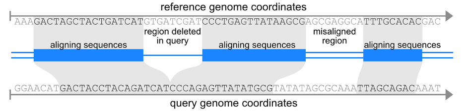

<p align="center">
<p align="center">
  <picture>
    <source
      media="(prefers-color-scheme: dark)"
      srcset="./assets/figures/hillerlab-dark.png"
    >
    <source
      media="(prefers-color-scheme: light)"
      srcset="./assets/figures/hillerlab-light.png"
    >
    
  </picture>
</p>

  <span>
    <h1 align="center">
        <code>make_lastz_chains</code>
    </h1>
  </span>

  <p align="center">
    <a href="https://github.com/hillerlab/make_lastz_chains" reference="_blank">
      
    </a>
  </p>

  <p align="center">
    <samp>
        <span> portable solution for generating pairwise genome alignment chains  </span>
        <br>
        <span> The Hiller Lab at the Senckenberg Research Institute </span>
        <br>
        <br>
        <a href="https://genome.ucsc.edu/goldenPath/help/chain.html">format</a> .
        <a href="http://genomewiki.ucsc.edu/index.php/Chains_Nets">chains</a> .
        <a href="https://github.com/hillerlab/make_lastz_chains/blob/main/assets/pipeline/make_lastz_chains.mermaid">pipeline</a> 
    </samp>
  </p>

</p>

---

<p align="center">
  
</p>

---

> [!IMPORTANT]
> - **Softmask both genomes** (lowercase, do NOT hardmask). RepeatModeler 2 per genome is recommended; add WindowMasker if you see runaway LASTZ runtimes. We also provide a soft-masking solution in [softmask](https://github.com/hillerlab/softmask).
> - **Scaffold names**: no spaces; avoid dots (rename `NC_00000.1` → `NC_00000`)
> - Inputs accepted: `.fasta` or `.2bit`.
> - **Container image**: We offer a pre-built container image for the whole pipeline as well as individual modules. By default the pipeline runs with [ghcr.io/hillerlab/make_lastz_chains:latest](https://github.com/hillerlab/containers/pkgs/container/make_lastz_chains). Additional images can be found at [containers](https://github.com/hillerlab/containers) and nextflow modules at [core](https://github.com/hillerlab/core).
> - **UCSC replacement**: As of >=3.1.0, the pipeline uses [chaintools](https://github.com/alejandrogzi/chaintools), a Rust library to work with .chain files. As of >=3.1.5, the pipeline uses [psltools](https://github.com/alejandrogzi/psltools), a Rust library to work with .psl files.

---

## Usage

> [!TIP]
> We recommend running the pipeline test suite with:
> ```bash
> nextflow run main.nf -profile test,apptainer
> ```
> To ensure that the pipeline runs on your system.

> [!NOTE]
> Requirements: Nextflow ≥ 25.04.6 < 26, Docker or Apptainer, Java.

```bash
git clone https://github.com/hillerlab/make_lastz_chains.git
cd make_lastz_chains
```

Edit `params.json` (set `reference_name`, `query_name`, `reference_genome`, `query_genome`), then:

```bash
# Docker
nextflow run main.nf -params-file params.json -profile docker

# Apptainer / Singularity
nextflow run main.nf -params-file params.json -profile apptainer
```

Alternatively, keep the alignment settings in `params.json` and provide the genome paths and output directory as command-line arguments:

```bash
nextflow run main.nf -params-file params.json -profile docker \
    --reference_genome /path/to/reference.2bit \
    --query_genome /path/to/query.2bit \
    --outdir results
```

Command-line parameters override matching values from `params.json`; all other parameters continue to come from the file.

Many query genomes against one reference (`--aligner hspz` only): list one query genome per line and pass the list with `--array` instead of `--query_genome`/`--query_name`. Without `--array` nothing changes.

```bash
# queries.txt — one FASTA or .2bit path per line; '#' and blank lines are skipped
/data/genomes/mm39.fa
/data/genomes/rn7.2bit

nextflow run main.nf -params-file params.json -profile docker,gpu --aligner hspz \
    --reference_name hg38 --reference_genome /data/genomes/hg38.2bit \
    --array queries.txt --outdir results
```

- **One GPU stage.** All queries share a single hspZ `--query-list` batch. Each reference bin is built once for the whole list, and every query's segments are byte-identical to its own single run.
- **One bubble per query.** Each query then runs its own LASTZ extension, chain building, filling and cleaning, and publishes into `results/<query>/`. Its final chain is `results/<query>/07_final/<reference>.<query>.allfilled.chain.gz`.
- **Naming.** Queries are named after their files, without `.gz` and `.fa`/`.fasta`/`.fna`/`.2bit`, so file names must be unique.
- **Limits.** Full runs only (no `--from`). The GPU task holds every query in host RAM, and a failing query stops the run. The GPU gain is largest for many small queries; for whole genomes it is under 1%.

Resume runs from checkpoints [segments, chain_antirepeat, fill_chains, clean_chains]:
```bash

# Restart after hspZ GPU seeding but before gapped extension [ 02_hspz/segments ]
# (the first run needs --save_segments: the segments are not published by default)
nextflow run main.nf --from segments -profile <PROFILE> -params-file params.json \
    --segments_path  results/02_hspz/segments

# Restart after alignment but before repeat-cleaning them [ 04_axtchain ]
nextflow run main.nf -profile <PROFILE> -params-file params.json \
    --from chain_antirepeat \
    --axtchain_path  results/04_axtchain

# Restart after alignment but before filling chains [ 04_axtchain/merged_chains ]
nextflow run main.nf -profile <PROFILE> -params-file params.json \
    --from fill_chains \
    --merged_chain_path  results/04_axtchain/merged_chains/<CHAIN> 

# Restart afterf filling chains but before cleaning them [ 05_filled_chains ]
nextflow run main.nf -profile <PROFILE> -params-file params.json \
    --from clean_chains \
    --filled_chain_path  results/fill_chains/hg38.mm39.filled.chain.gz 
```

> [!NOTE]
> You can also specify these options directly in `params.json`.

A helper sh script is provided to run the pipeline on a SLURM cluster. See details below.

<details>
<summary>Click to expand</summary>


Edit the path variables at the top of `assets/scripts/make_lastz_chains.sh` (cache dir, container image, manifest path), then submit:

```bash
sbatch --array=1-<N> make_lastz_chains.sh
```

Each array task spawns one Nextflow head job that submits all compute as child SLURM jobs.

LASTZ, AXT_CHAIN, REPEAT_FILLER and LASTZ_FILL run as SLURM job arrays. Partition routing, array sizes, and resource tiers are documented inline in `nextflow.config` — edit there to match your cluster.

</details>

---

## Alignment backend

`--aligner` picks which aligner produces the PSL alignments. Everything downstream
(chain building, filling, cleaning) is identical for both.

```
                    PREPARE_GENOMES ──► .2bit + chrom.sizes
                              │
              ┌───────────────┴────────────────┐
              │                                │
      aligner=lastz                    aligner=kegalign (gpu profile)
              │                                │
      LASTZ_ALIGNMENT (CPU)             KEGALIGN_ALIGNMENT
      PARTITION_REFERENCE /            REFERENCE_TO_FA / QUERY_TO_FA
      PARTITION_QUERY                  (.2bit → FASTA)
              │                                │
      N × LASTZ (run_lastz.py)         KEGALIGN [kegalign-full, GPU]
              │ psl per pair           runner.py --output-type tarball
              │                        faToTwoBit → work/{ref,query}.2bit
              │                        kegalign --format axt+ (K,L,H,Y thresholds)
              │                        package_output.py → data_package.tgz
              │                        (mps_workers > 1: KEGALIGN_MPS instead —
              │                         split_input.py bins both genomes,
              │                         run_mig.py runs N kegalign instances on
              │                         one MPS-shared GPU → one keg per bin pair)
              │                                │
              │                  ┌─────────────┴──────────────┐
              │           executor=batched          executor=distributed
              │           KEGALIGN_LASTZ            KEGALIGN_EXPAND
              │           run_lastz_tarball.py      (parse commands.json)
              │           [kegalign-full]                  │
              │           → .axt                   N × KEG_LASTZ
              │           → AXT_TO_PSL             run_keg_lastz.py
              │           → .psl                   → .psl each
              │                  └─────────────┬──────────────┘
              │                                │
              │              psl_gz: (meta, [psl_files])  ← same contract
              └───────────────┬────────────────┘
                              │
                       CHAIN_BUILD (identical downstream)
              PSLTOOLS_SPLIT ─► bundles ─► AXT_CHAIN ─► chainc ─► … ─► .chain.gz
```

Both backends converge on the identical `psl_gz` contract, so chain building,
filling and cleaning are unchanged. `--aligner hspz` hands `CHAIN_BUILD` PSL
that `LASTZ_SEGMENTED` already wrote per reference chromosome, so it skips
`PSLTOOLS_SPLIT`. Bundles are planned from `chrom.sizes` without copying any
PSL, and `AXT_CHAIN` streams each bundle's files into `axtChain`.

```bash
# CPU LASTZ over partitioned chunks (default)
nextflow run main.nf -params-file params.json -profile docker --aligner lastz

# KegAlign: GPU seeding + HSP filtering, then batched CPU LASTZ gapped extension
nextflow run main.nf -params-file params.json -profile docker,gpu --aligner kegalign

# ...with each KegAlign partition as its own Nextflow task (spreads across nodes)
nextflow run main.nf -params-file params.json -profile docker,gpu \
    --aligner kegalign --kegalign_executor distributed

# ...with 2 KegAlign instances sharing the one allocated GPU through NVIDIA MPS
nextflow run main.nf -params-file params.json -profile docker,gpu \
    --aligner kegalign --kegalign_mps_workers 2

# hspZ: GPU seeding at lastz_k (--hspthresh), then per-partition LASTZ gapped extension
nextflow run main.nf -params-file params.json -profile docker,gpu --aligner hspz

# ...seeding on 4 GPUs instead of the default 2
nextflow run main.nf -params-file params.json -profile docker,gpu --aligner hspz --hspz_gpus 4
```

`--hspz_gpus` (default 2) is how many GPUs hspZ's seeding step uses. It is also the
number of GPUs that task requests, so a SLURM job asks for that many. The output is the
same for any value. Set 1 on a single-GPU machine (the `zluda` profile does): with fewer
GPUs than requested, hspZ shares them and runs no faster. The hspz fill engine
(`--repeat_filler_engine hspz`) always seeds the gaps on one GPU.

`--kegalign_executor` chooses how the KegAlign backend runs its CPU gapped-extension
stage. `batched` (default) hands every partition to KegAlign's own process pool in a
single Nextflow task. `distributed` fans the partitions out as one task each, so each
caches, retries and escalates resources on its own and the work spreads across nodes;
on SLURM they are submitted as job arrays. Both consume the identical KegAlign
package and run the identical LASTZ commands, so they are scientifically equivalent —
`assets/tests/ci/compare_aligners.sh` asserts their normalised PSL and chains match exactly.

`--kegalign_mps_workers N` (N > 1) keeps the GPU busy by running N KegAlign instances
concurrently on the **same single allocated GPU** through the NVIDIA MPS daemon — one
SLURM job, one GPU, N `kegalign` processes. Upstream's `split_input.py` bins both
genomes at a ~200 Mb goal without splitting chromosomes, upstream's `run_mig.py`
schedules the bin pairs, and each pair is packaged as its own keg; the CPU stage then
runs once per keg. Scoring, format and diagonal partitioning are untouched, so MPS
changes scheduling only. It needs `--kegalign_executor batched`, and roughly 12–16 GiB
of VRAM per instance — start with 2 on a 32–40 GB GPU, try 4 only on 80 GB. `1`
(default) never starts an MPS daemon and is exactly the single-instance path above.

> [!IMPORTANT]
> `kegalign` and `hspz` need the `gpu` (or `zluda`) profile (`--gpus all` for Docker, `--nv` for
> Apptainer/Singularity) — there is no CPU fallback, and requesting either without a GPU
> runtime fails at startup rather than silently reverting to LASTZ. Both do their
> own reference/query partitioning, so `seq1_chunk` / `seq2_chunk` / `seq1_lap` /
> `seq2_lap` are unused for those backends. The four LASTZ scoring thresholds are
> shared: `lastz_k` → `--hspthresh` (hspZ included — do not pass `-H`, that short
> flag is `--hspthresh` not BLASTZ inner), `lastz_l` → `--gappedthresh`,
> `lastz_h` → `--inner`, `lastz_y` → `--ydrop`. With `--save_psl`, PSL lands in
> `02_kegalign_psl/` or `02_hspz/psl/`.

### Very close species: `--window_masking_recovery` (CPU lastz)

Very close species can share large satellite arrays that the genomes' repeat
masking missed. For example, a 20-bp-unit satellite escapes UCSC-style TRF
masking, which keeps only periods ≤ 12. lastz then finds tens of millions of
anchors in one job and stops with `init_from_anchors(): structure size would
exceed 2^32`, and by default the run fails with a hint pointing here.

With `--window_masking_recovery true`, such a job is recovered instead:
1. The job is marked rather than failed.
2. WindowMasker + sdust runs once per genome (UCSC's `windowmaskerSdust`
   recipe) and is added to each genome's own soft-masking.
3. The job is re-run on the masked chromosomes, split 5×5.
4. The masked genomes replace the originals for every later step: chaining,
   anti-repeat, fill and clean.

This is what the old Hiller lab pipeline did. Because anti-repeat discounts
masked bases, the masked genomes drop many small repeat-derived chains: on two
*Myotis* bats, ~3× fewer chains score below 100k. Both masked genomes and their
intervals are published in `00_genome_prep/window_masking/`.

Without an overflow nothing changes and nothing extra runs. After one,
WindowMasker takes ~20 min and < 1 GB per 2 Gb genome. Recommended for very close
species (e.g. two *Myotis* bats).

```bash
nextflow run main.nf -params-file params.json -profile docker --aligner lastz --window_masking_recovery true
```

### Very close species: `--dense_windows` (hspZ)

On the hspZ path lastz never overflows, because each task gets at most ~50k
anchors. It slows down instead: in a shared satellite array every anchor sits on
its own tandem diagonal and costs a ~34 kb extension. On two *Myotis* bats,
LASTZ_SEGMENTED needed ~4,770 CPU h, almost all of it in a handful of arrays.

Before lastz starts, `DENSE_WINDOWS` reads hspZ's anchors in two steps:

1. **Trigger.** A 100 kb × 100 kb block (one reference chromosome × one query
   chromosome × one strand) holds ≥ 100k anchors. hg38 × mm39 peaks at 13.6k
   anchors per block; *Myotis* pairs at 1.5–3.4 M. Without a trigger, nothing
   else happens and the run is unchanged.
2. **Regions.** Anchors are counted per 10 kb window along each genome, summed
   over every partner chromosome. A window with ≥ 100k anchors seeds a region,
   which grows through adjacent windows with ≥ 10k. Summing over partners
   catches arrays whose anchors are spread too thin for any one block.

| `--dense_windows` | when triggered |
|---|---|
| `report` (default) | warn, and publish the report and the regions in `02_hspz/dense_windows/` |
| `filter` | drop the anchors inside the regions; chaining, fill and clean read the genomes with the regions soft-masked (`*.dense.2bit`, published there too) |
| `fail` | stop before any lastz job starts |
| `off` | skip the scan |

On HLmyoMyot9A × HLmyoDau2, the scan takes 4–8 min on 16 cores. It flags 75 + 72
regions (5.2 + 5.6 Mb), and `filter` keeps 33.2 M of 346.8 M anchors, about as many
as hspZ finds with the regions soft-masked beforehand. With `filter`,
LASTZ_SEGMENTED needed 51.5 CPU h instead of ~4,770 (longest task 35 min), and
the whole run (`--from segments`, SLURM) took 2 h 23 min and 72 CPU h. Its final
chains are within 0.3% of a run on the pre-masked genomes. On the CPU path, the
same regions cover all 17 jobs that overflowed lastz in the old pipeline's run,
and each of them finished once the regions were masked.
Recommended: `filter` for very close species. It also applies to `--from segments`.

```bash
nextflow run main.nf -params-file params.json -profile docker,gpu --aligner hspz --dense_windows filter
```

### Known satellite arrays of the reference: `--mask_reference_regions_bed` (hspZ)

Some arrays never trigger `--dense_windows`. hs1's HSat3 (chr15 short arm, chrY)
is 97.5% soft-masked, and the anchors in its unmasked islands are too sparse for
any block to reach 100k (elephants peak at 28k). Each of them still makes lastz
extend through megabases of soft-masked satellite: alignments of 1.7 Mb, cut off
by lastz's traceback memory, and LASTZ jobs that time out at 1 h, 4 h and 8 h.

`--mask_reference_regions_bed` names such regions on the reference. In every
`--dense_windows` mode (also `off`), whether or not the scan triggers,
`DENSE_WINDOWS` drops the anchors whose reference span overlaps them, and
chaining, fill and clean read the reference with them soft-masked
(`REFERENCE_MASK_BED`, once per run). The dropped regions are published as
`*.mask_reference.bed` in `02_hspz/dense_windows/`; the masked reference itself
is not (it is the reference plus the BED). Alignments that start outside a
region can still extend into it.

For hs1, the T2T censat annotation's HSat1A, HSat1B, HSat2, HSat3, beta-satellite and rDNA
arrays (315 intervals, 145 Mb) drop 20.0 M of HLloxAfr5A's 62.3 M anchors in 41 s, and every
anchor of the six LASTZ jobs that had run more than 4.8 h. On species without the problem they
drop 0.1–1.9%. Alpha satellite is primate-specific (0.001–0.005% of anchors against other
mammals), so it is left out of the BED unless the query is a primate.

```bash
nextflow run main.nf -params-file params.json -profile docker,gpu --aligner hspz \
    --mask_reference_regions_bed hs1.satellite_arrays.bed
```

### Low-complexity tandem repeats: `--dust_masking`

A genome's soft-masking can miss simple tandem repeats. hs1 leaves GA- and
CT-rich minisatellites (16–35 bp period, 0.5–1 kb) in uppercase, and each one
seeds against every similar tract of the query. Counted over 37 hs1 × mammal
pairs, the unmasked part of such tracts — 0.5% of the genome — held 21–96% of
all hspZ anchors and every 1 kb bin with ≥ 50,000 anchors; pairs with the most
ran axtChain for more than 8 h on millions of 25–100 bp chains.

`--dust_masking` runs NCBI `dustmasker` (window 64, level 20) on the reference
and on every query, joins its intervals across gaps ≤ 10 bp, and soft-masks the
tracts of at least `--dust_min_tract` bp (default 100; 0 masks every interval)
into the genomes, on top of their own masking, before any other step. Seeding,
chaining, fill and clean then all read the same masked genomes; lastz still
extends alignments through masked sequence from anchors outside it. The tracts
are published as `00_genome_prep/dust/*.dust.bed`.

On hs1 the tracts ≥ 100 bp are 382,679 intervals (118 Mb), 81–87% of it already
lowercase. They overlap 0.56% of RefSeq coding bases, and 415 of 242,357 coding
exons lie mostly inside one. dustmasker takes 8 min for hs1 on one core.
It works with every `--aligner`.

```bash
nextflow run main.nf -params-file params.json -profile docker,gpu --aligner hspz --dust_masking
```

### Many runs against one reference: `--reference_cache_dir`

Each run rebuilds what depends on the reference alone: its FASTA (3 GB for a
human genome), its `--dust_masking` files and its `--mask_reference_regions_bed`
copy. `--reference_cache_dir DIR` keeps them in `DIR` and later runs take them
from there instead of running the tasks (Nextflow reports them as *Stored*).

Entries sit in `DIR/<reference name>.<file size>.<modification time>[.dust<N>]/`,
one subdirectory per step, and the masked copy is keyed by the BED's md5, so a
changed reference file, DUST setting or BED gets its own entry. The tasks write
in the work directory and move the result into the cache; keep the cache on the
work directory's filesystem, where that move is a rename and concurrent runs
never see a half-written file.

### Big genomes (whose .2bit would exceed the v0 32-bit layout)

| backend    | reference ≤ ~16 Gbp, query < 6 GB | bigger than that |
|------------|-----------------------------------|------------------|
| `lastz`    | ✅ v1 .2bit via per-chrom FASTAs   | ✅ same path     |
| `hspz`     | ✅ FASTA to the GPU, per-chrom FASTAs to LASTZ | ✅ same path (query permitting) |
| `kegalign` | ✅ `.2bit` hop skipped, keg CPU commands read per-block FASTAs | ❌ queries > ~6 GB hit KegAlign's query DRAM buffer — the task fails fast naming `--aligner lastz`/`hspz` as v1-capable |

`kegalign --kegalign_mps_workers > 1` is unaffected: bins are chromosome-granular and
always v0-safe, so MPS never touches the big-genome path (a single > ~6 GB chromosome
still dies in the binary with its own DRAM message). `--force_long_2bit` exercises
every row's big-genome path on small test data.

> [!TIP]
> On an **AMD GPU**, `bash assets/tests/ci/zluda_setup.sh` plus
> `-profile docker,gpu,zluda` runs the KegAlign stages natively against a local
> [ZLUDA](https://github.com/vosen/ZLUDA) build (everything else stays
> containerised), so the GPU backend can be developed and tested without NVIDIA
> hardware. `--kegalign_mps_workers > 1` still cannot run there — NVIDIA MPS does
> not exist on AMD and the preflight says so. See `assets/tests/README.md`.

---

## Fill engine

`--repeat_filler_engine` picks how chain gaps are filled. Both engines patch the
same gaps (chain score ≥ `min_chain_score`, gap sizes within
`fill_gap_{min,max}_size_{t,q}`) and put in the best mini-chain scoring at least
`fill_insert_chain_min_score`.

- **`lastz` (default)** — RepeatFiller: one `lastz | axtChain | chainSort` per gap,
  over `num_fill_jobs` chunks of whole chains.
- **`hspz`** — every gap becomes one target and one query record (gap-local, plus
  strand, uppercased unless `skip_fill_unmask`). hspZ `run --paired` (≥ 0.0.6) seeds
  all of them in one GPU task at `fill_lastz_k`; lastz then extends from those
  anchors (`fill_lastz_l`) and axtChain chains each shard from its FASTAs, and the
  best mini-chains are spliced back. Gaps, not chains, are split over
  `fill_hspz_shards` shards (default 100), so one dominant chain no longer holds a
  whole task; the filled chains do not depend on the count. Needs `-profile gpu`
  (or `zluda`); works with any `--aligner`.

```bash
nextflow run main.nf -params-file params.json -profile docker,gpu --repeat_filler_engine hspz
```

`assets/tests/ci/compare_fill.sh` checks the engine. With lastz's own anchors in
place of hspZ (a CPU stand-in), the hspz engine reproduces the lastz engine's
`05_filled_chains` byte for byte. With the real hspZ, the bases it adds must stay
within `FILL_TOLERANCE` of the lastz engine's.

On hg38 × mm39 (1.46 M fillable gaps, one NVIDIA L4), the hspz engine adds the
same aligned bases as the lastz engine to within 0.001% (89,376,800 vs 89,376,162
bp), with the same chains. End to end, on 2 A100s and 128 CPUs, the whole pipeline
took 1 h 20 m instead of 2 h 35 m and 40.8 CPU hours instead of 95.6. The fill stage
took 0.20 h and 2.7 CPU hours instead of 1.44 h and 57.5.

## Output

```
results/
├── 00_genome_prep/      reference.2bit, query.2bit, *.chrom.sizes
├─── • dust/             *.dust.bed         ← --dust_masking
├── 01_partition/        *_partitions.txt
├── 02_lastz_psl/        *.psl              ← --aligner lastz, --save_psl only
├── 02_kegalign_psl/     *.psl              ← --aligner kegalign, --save_psl only
├── 02_hspz/                                ← --aligner hspz
├─── • segments/         *.segments         ← checkpoint for --from segments, --save_segments only
├─── • dense_windows/    *.dense_windows.tsv, regions *.bed  ← --dense_windows, --mask_reference_regions_bed; *.dense.2bit with filter
├─── • psl/              <chrom>/*.psl.gz   ← --save_psl only
├── 03_psl/              *.psl              ← per-chr psl files (lastz, kegalign), --save_psl only
├── 04_axtchain/         *.chain            ← checkpoint for --from chain_antirepeat
├─── • chain_antirepeat/ *.chain.gz
├─── • merged_chains/    *.all.chain.gz     ← checkpoint for --from fill_chains
├── 05_filled_chains/    *.filled.chain.gz  ← checkpoint for --from clean_chains
├── 06_cleaned_chains/   *.chain, *.removed.bed
├── 07_final/            *.allfilled.chain.gz   ← final output
└── pipeline_info/    timeline, trace, DAG
```

With `--array`, `00_genome_prep/`, `02_hspz/segments/` and `pipeline_info/` stay shared. `02_hspz/segments/` holds one `segments/<query>/` directory per query plus hspZ's `queries.tsv`. Every other step directory moves under `results/<query>/`.

---

## Where to edit

| File | What |
|------|------|
| `params.json` | Genome paths, alignment settings, checkpoints — per run |
| `nextflow.config` | Compute resources, profiles, container, SLURM — rarely |

---

## Citation

- Gonzales-Irribarren A, Mu NT, Kirilenko BM, Hiller M. *make_lastz_chains: A portable solution to generate genome alignment chains using LASTZ*. In preparation.
